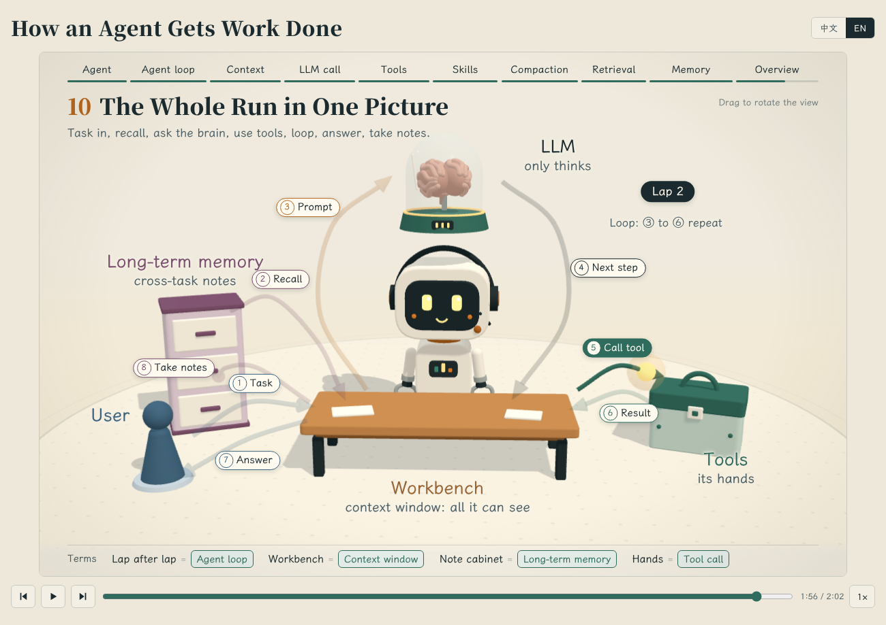

# Agent 是怎么干活的（3D 讲解动画）

用 three.js 画的一段可以播放的 3D 讲解动画：一个小机器人坐在工作台前，十幕讲清楚 AI Agent 的工作原理。页面支持中文和英文，标题右边的按钮可以切换。

## 怎么看

在线观看：<https://gangtao.github.io/how_agent_works/>

也可以把仓库下载下来，直接用浏览器打开 `index.html` 播放，不需要构建，也不需要服务器。

- 空格键播放或暂停，左右方向键切换上一幕和下一幕
- 顶部的进度菜单可以直接跳到某一幕
- 按住画面拖动可以转动视角

## 十幕内容

| 幕 | 标题 | 讲什么 |
|---|---|---|
| 1 | 认识 Agent | 大模型负责想，工作台放资料，工具是手，柜子里是笔记 |
| 2 | 一圈一圈地干 | 推理循环：摆桌面、问大脑、动手、看结果 |
| 3 | 桌面就是提示词 | 上下文窗口里放的七样东西，哪些可以缓存 |
| 4 | 大脑只动嘴，不动手 | 大模型逐个 Token 输出，要么是回答，要么是工具调用请求 |
| 5 | 动手之前先过门卫 | 内置工具和权限检查 |
| 6 | 技能：用到才翻开 | 技能的渐进式加载 |
| 7 | 桌面满了怎么办 | 工具结果清理和上下文压缩 |
| 8 | 开工前先翻笔记 | 记忆检索：打分，只取最相关的几条 |
| 9 | 记什么，忘什么 | 记忆的提取、更新、遗忘和整合 |
| 10 | 一张图看全程 | 把前面九幕串成一张完整的流程图 |

## 文件

- `index.html`：整个页面，样式、脚本和标签字体都在这一个文件里
- `tools/embed_font.py`：把霞鹜文楷按页面用到的字裁成子集并内嵌进页面。页面文字有增改后重跑：先 `pip install fonttools brotli`，再把 `LXGWWenKai-Medium.ttf` 放到 `tools/` 下，然后执行 `python3 tools/embed_font.py index.html`
- `docs/`：说明用的截图

页面里的文字默认是中文；脚本里有一张 `EN` 对照表（中文片段对应英文），新增中文文字时要在表里补一条英文。

## 用到的开源项目

- [three.js](https://threejs.org/) r128，MIT 许可，从 cdnjs 加载
- [霞鹜文楷 LXGW WenKai](https://github.com/lxgw/LxgwWenKai)，SIL OFL 1.1，页面内嵌了一个子集
- 思源宋体和思源黑体（Noto Serif SC、Noto Sans SC），SIL OFL 1.1，从 Google Fonts 加载

## 许可证

本仓库的代码采用 [MIT 许可证](LICENSE)。内嵌和加载的字体各自遵循 SIL OFL 1.1。

---

# How an Agent Gets Work Done (3D explainer)

A playable 3D explainer drawn with three.js. A small robot sits at a workbench, and ten scenes walk through how an AI Agent works. The page is bilingual: use the button next to the title to switch between Chinese and English.

## Viewing

Watch it online: <https://gangtao.github.io/how_agent_works/>

Or download the repository and open `index.html` in a browser. There is no build step and no server.

- Space plays or pauses; the left and right arrow keys move between scenes
- The progress menu at the top jumps straight to a scene
- Drag the picture to rotate the view

## The ten scenes

| # | Title | What it covers |
|---|---|---|
| 1 | Meet the Agent | The LLM thinks, the workbench holds materials, tools are hands, the cabinet holds notes |
| 2 | One Lap at a Time | The agent loop: set the desk, ask the brain, act, check the result |
| 3 | The Desk Is the Prompt | The seven things in the context window, and which of them can be cached |
| 4 | The Brain Talks, It Doesn't Act | The LLM emits one Token at a time: either an answer or a tool call request |
| 5 | Past the Gatekeeper First | Built-in tools and permission checks |
| 6 | Skills: Opened Only When Needed | Progressive disclosure of skills |
| 7 | When the Desk Fills Up | Tool result clearing and compaction |
| 8 | Check the Notes Before Starting | Memory retrieval: score everything, take the top few |
| 9 | What to Keep, What to Forget | Memory extraction, update, forgetting and consolidation |
| 10 | The Whole Run in One Picture | All nine scenes joined into one flow |

## Files

- `index.html`: the whole page, with styles, script and the label font in one file
- `tools/embed_font.py`: subsets LXGW WenKai to the characters the page uses and embeds it. Re-run after changing page text: `pip install fonttools brotli`, put `LXGWWenKai-Medium.ttf` in `tools/`, then run `python3 tools/embed_font.py index.html`
- `docs/`: screenshots for this README

Page text is written in Chinese. The script holds an `EN` table that maps each Chinese fragment to English, so new Chinese text needs a matching entry there.

## Open-source credits

- [three.js](https://threejs.org/) r128, MIT license, loaded from cdnjs
- [LXGW WenKai](https://github.com/lxgw/LxgwWenKai), SIL OFL 1.1, a subset is embedded in the page
- Noto Serif SC and Noto Sans SC, SIL OFL 1.1, loaded from Google Fonts

## License

The code in this repository is released under the [MIT License](LICENSE). The embedded and loaded fonts remain under SIL OFL 1.1.
